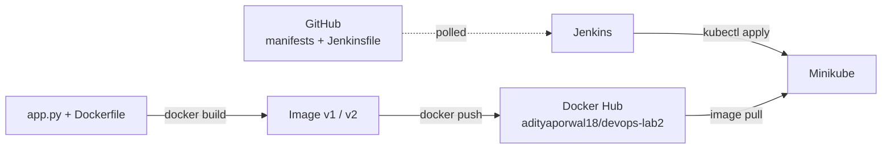
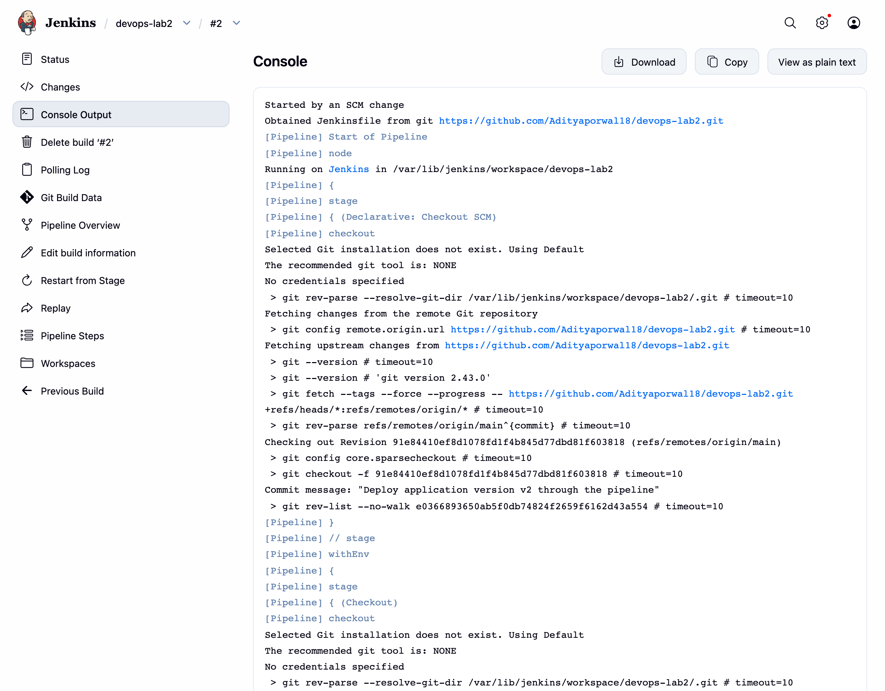

# Lab 2 - Containerization & Kubernetes Orchestration

**Course:** DevOps and Automation Lab (ENSP461)  
**Student:** Aditya Porwal | **GitHub:** `Adityaporwal18` | **Docker Hub:** `adityaporwal18`  
**Application:** a small Flask web application, packaged with Docker and deployed to Kubernetes (Minikube) by a Jenkins pipeline.  
**Environment:** Ubuntu 24.04.5 LTS virtual machine, Docker 29.10.1, Minikube v1.39.0 (Kubernetes v1.37.0), Jenkins 2.580.2. Lab run on 25 November 2026.

## Documentation

| Document | Contents |
|---|---|
| [Lab report](REPORT.md) | Q1-Q9: procedure, results, architecture and observations |
| [Evidence gallery](docs/EVIDENCE.md) | Screenshots of every step with captions, plus links to the logs |
| [Commands executed](commands.txt) | The commands that were run, grouped by question |
| [Logs](docs/evidence/logs) | Terminal logs, Jenkins console logs and the Git polling log |

## What the lab covers

| Question | Topic | Result |
|---|---|---|
| Q1 | Containerize the application | Image `devops-lab2:v1` built and run on port 5000 |
| Q2 | Manage containers and images | Stop/start/remove, tags, Docker Compose, push to Docker Hub |
| Q3 | Docker storage | Data loss without a volume, named volume, bind mount |
| Q4 | Docker network | Ping by container name and by IP on a custom network |
| Q5 | Deploy to Kubernetes | Deployment (2 replicas) and Service on Minikube |
| Q6 | Deployment strategies | Scale to 4, rolling update to v2, rollback to v1 |
| Q7 | Continuous deployment | Jenkins applies the manifests after a Git push |
| Q8-Q9 | Records and report | This repository and [REPORT.md](REPORT.md) |

## End-to-end flow





## Run it yourself

In an Ubuntu terminal with Docker installed:

```bash
git clone https://github.com/Adityaporwal18/devops-lab2.git
cd devops-lab2
docker build -t devops-lab2:v1 .
docker run -d --name lab2-app -p 5000:5000 devops-lab2:v1
curl http://localhost:5000/health
```

On Kubernetes (Minikube running, kubectl configured):

```bash
kubectl apply -f kubernetes/deployment.yaml
kubectl apply -f kubernetes/service.yaml
kubectl rollout status deployment/devops-lab2
kubectl port-forward service/devops-lab2-service 8081:5000
```

The published images are `adityaporwal18/devops-lab2:v1` and `:v2`. They were built on an ARM machine (`linux/arm64`).

## Main files

```text
app.py                      Flask application (/, /health)
requirements.txt            Flask 3.1.2
Dockerfile                  Image definition (python:3.12-slim)
compose.yaml                Web service + Redis
kubernetes/deployment.yaml  Deployment, 2 replicas, image from Docker Hub
kubernetes/service.yaml     NodePort Service (30080 -> 5000)
Jenkinsfile                 Checkout -> Deploy to Kubernetes -> Verify
jenkins/job-config.xml      Jenkins job definition (Pipeline script from SCM)
bind-data/                  Files created by the bind-mount experiment
commands.txt                Commands executed in the lab
REPORT.md                   Lab report
docs/EVIDENCE.md            Evidence gallery
docs/evidence/              Screenshots and logs
```
