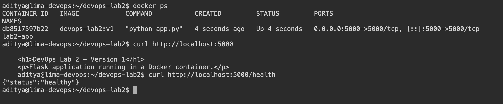
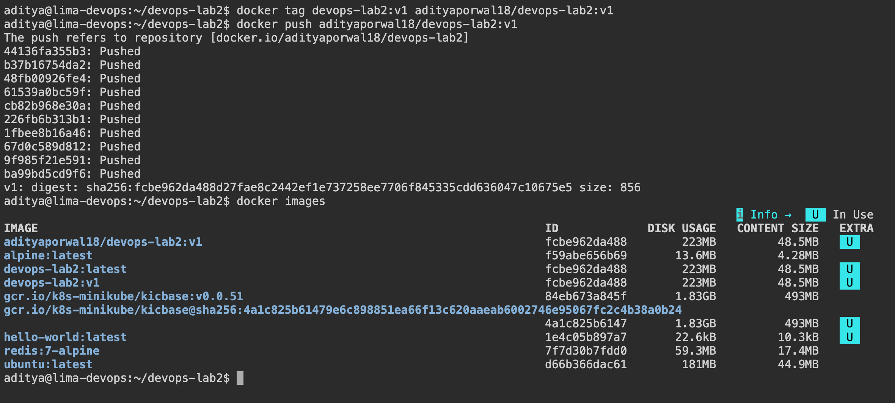
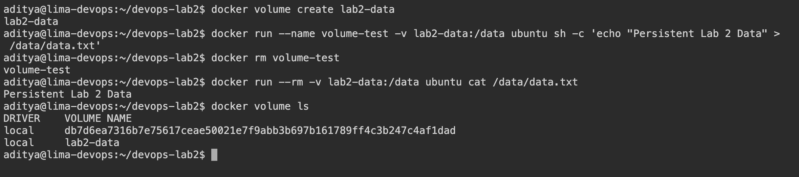
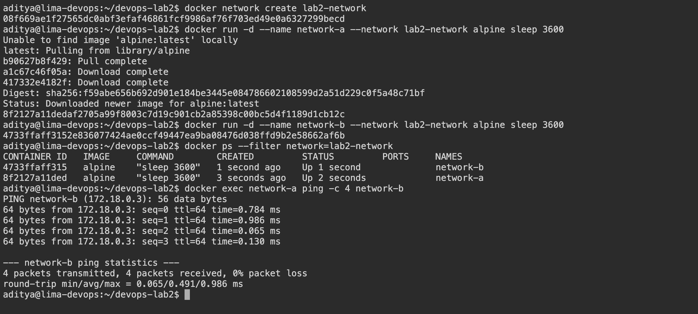
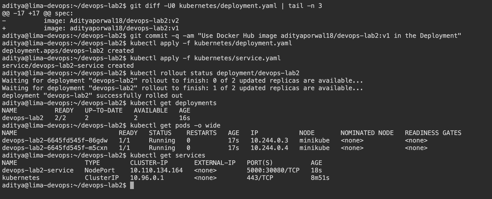
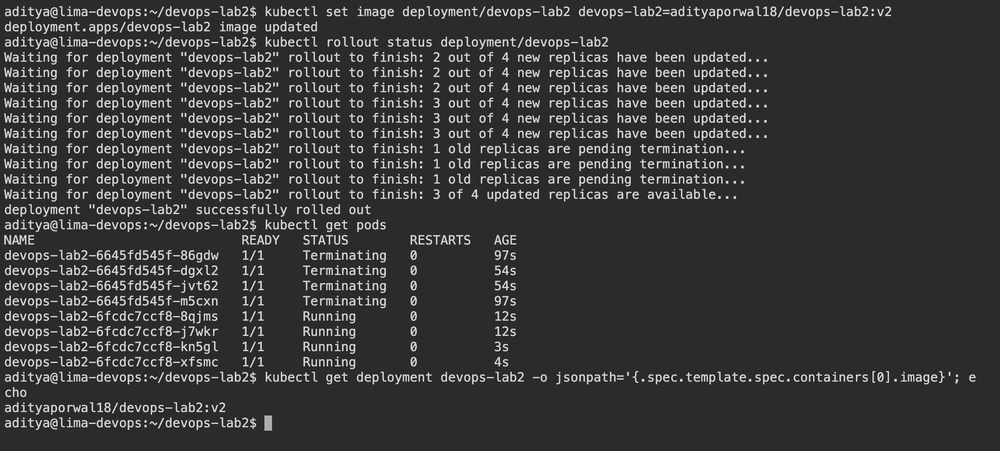
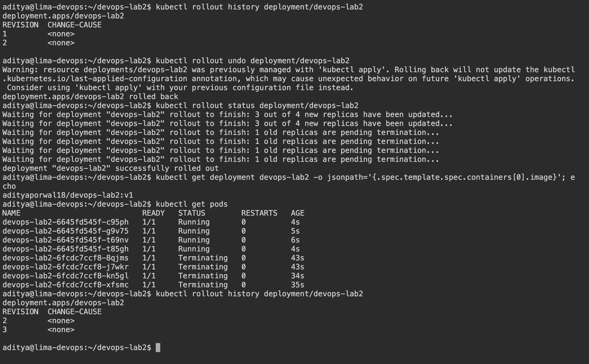
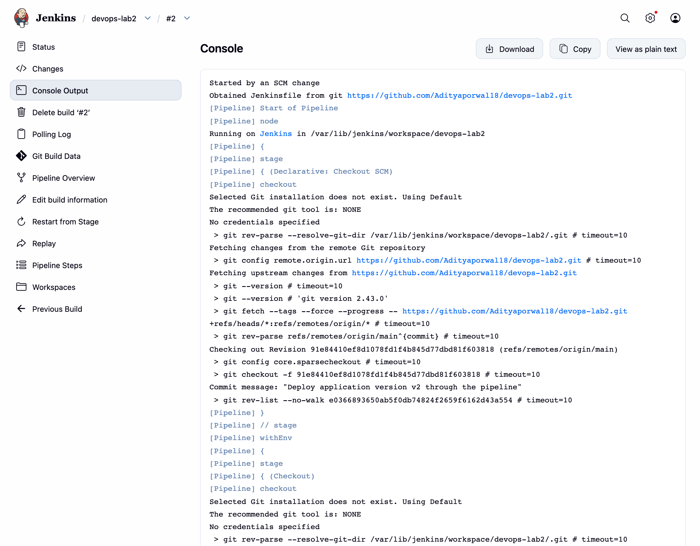
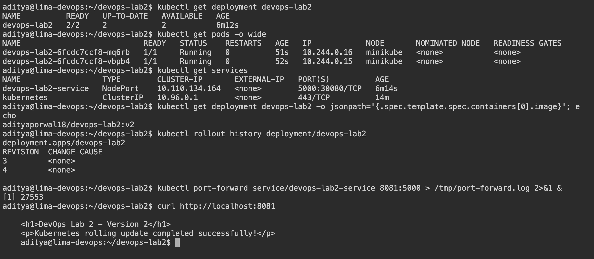
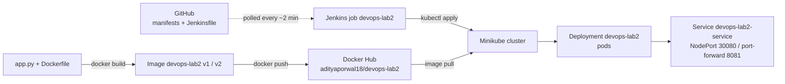

# Lab 2 Report - Containerization & Kubernetes Orchestration

**Course:** DevOps and Automation Lab (ENSP461)  
**Student:** Aditya Porwal  
**Repository:** https://github.com/Adityaporwal18/devops-lab2  
**Docker Hub:** https://hub.docker.com/r/adityaporwal18/devops-lab2  
**Environment:** Ubuntu 24.04.5 LTS virtual machine (Lima 2.3.0) on a MacBook Pro (Apple M1, macOS 26.4)  
**Date of this run:** 25 November 2026

[Repository overview](README.md) | [Evidence gallery](docs/EVIDENCE.md) | [Commands executed](commands.txt)

## 1. Aim

To containerize a sample application with Docker and orchestrate it with Kubernetes: build and run an image, manage containers and images, publish to a registry, demonstrate Docker storage and networking, deploy to Kubernetes with Minikube, scale, update and roll back the deployment, and automate the deployment with Jenkins.

## 2. Environment and tools

| Component | Observed value |
|---|---|
| Operating system | Ubuntu 24.04.5 LTS, aarch64 (virtual machine with 4 CPUs and 4 GiB RAM) |
| Docker Engine / Compose | 29.10.1 / v5.8.0 (Docker's official apt repository) |
| Registry | Docker Hub, account `adityaporwal18` |
| kubectl / Minikube | v1.37.2 / v1.39.0 (Docker driver) |
| Kubernetes | v1.37.0, containerd 2.3.4, single node |
| Jenkins | 2.580.2 (installed in Lab 1) |
| Python / Flask | Base image `python:3.12-slim`, Flask 3.1.2 |

Evidence: [tool versions](docs/evidence/screenshots/47-tool-versions.png)

## 3. Sample application

[app.py](app.py) is a small Flask web application. It listens on port 5000, serves a page that shows the application version at `/`, and returns `{"status":"healthy"}` at `/health`. Version 1 and Version 2 differ only in the page text, which makes the running version easy to see.

## Q1 - Containerize a sample application using Docker

**Procedure.** Docker Engine was installed from Docker's apt repository and verified with `hello-world`. The image was built from the [Dockerfile](Dockerfile) and started as a container:

```bash
docker build -t devops-lab2:v1 .
docker history devops-lab2:v1
docker run -d --name lab2-app -p 5000:5000 devops-lab2:v1
curl http://localhost:5000
curl http://localhost:5000/health
```

**Image layers.** `docker history` shows the six Dockerfile steps on top of the base image:

| Dockerfile instruction | Layer size |
|---|---|
| `WORKDIR /app` | 8.19 kB |
| `COPY requirements.txt .` | 12.3 kB |
| `RUN pip install --no-cache-dir -r requirements.txt` | 15.5 MB |
| `COPY app.py .` | 12.3 kB |
| `EXPOSE 5000`, `CMD ["python", "app.py"]` | 0 B (metadata only) |

**Result.** The image `devops-lab2:v1` (223 MB on disk) was built, and the container answered on port 5000 with the Version 1 page and a healthy status.



Evidence: [Q1 in the gallery](docs/EVIDENCE.md#q1---containerize-a-sample-application-using-docker)

## Q2 - Manage Docker containers and images

| Task | Commands | Result |
|---|---|---|
| List, stop, start | `docker ps -a`, `docker stop lab2-app`, `docker start lab2-app` | Status changed from Up to Exited and back to Up |
| Tag | `docker tag devops-lab2:v1 devops-lab2:latest` | Two tags for the same image ID |
| Remove | `docker run -d --name lab2-temp ...`, `docker stop`, `docker rm` | Temporary container removed |
| Compose | `docker compose up -d`, `docker compose ps`, `docker compose down` | Web service (port 5001) and Redis started and removed together |
| Registry | `docker login`, `docker tag`, `docker push adityaporwal18/devops-lab2:v1` | Image published on Docker Hub |



Evidence: [Q2 in the gallery](docs/EVIDENCE.md#q2---manage-docker-containers-and-images)

## Q3 - Docker storage

| Case | What was done | Observed |
|---|---|---|
| Container-local data | File written inside a container, container removed, file read from a new container | `cat: /tmp/data.txt: No such file or directory` - the data is lost |
| Named volume | File written to volume `lab2-data`, container removed, volume mounted in a new container | `Persistent Lab 2 Data` - the data survives |
| Bind mount | Host directory `bind-data/` mounted into containers | A host file is readable in the container, and a file written by the container appears on the host |



Evidence: [Q3 in the gallery](docs/EVIDENCE.md#q3---docker-storage)

## Q4 - Docker network

A user-defined bridge network `lab2-network` (subnet 172.18.0.0/16) was created and two Alpine containers were attached to it.

| Test | Command | Observed |
|---|---|---|
| By name | `docker exec network-a ping -c 4 network-b` | 4 packets sent, 4 received - Docker's built-in DNS resolved the name to 172.18.0.3 |
| By IP | `docker exec network-a ping -c 4 172.18.0.3` | 0% packet loss |
| Inspect | `docker network inspect lab2-network` | Bridge driver, both containers attached (172.18.0.2 and 172.18.0.3) |



Evidence: [Q4 in the gallery](docs/EVIDENCE.md#q4---docker-network)

## Q5 - Deploy an application to Kubernetes

**Procedure.** kubectl and Minikube were installed and a single-node cluster was started with `minikube start --driver=docker`. The [Deployment](kubernetes/deployment.yaml) (2 replicas, image from Docker Hub) and the [Service](kubernetes/service.yaml) (NodePort 30080, port 5000) were applied:

```bash
kubectl apply -f kubernetes/deployment.yaml
kubectl apply -f kubernetes/service.yaml
kubectl rollout status deployment/devops-lab2
kubectl get deployments
kubectl get pods -o wide
kubectl port-forward service/devops-lab2-service 8081:5000
```

**Result.** The node became Ready, the Deployment reached 2/2 with two Running pods, and the Service returned the Version 1 page through port-forward on 8081.



Evidence: [Q5 in the gallery](docs/EVIDENCE.md#q5---deploy-an-application-to-kubernetes)

## Q6 - Kubernetes deployment strategies

| Strategy | Command | Observed |
|---|---|---|
| Scaling | `kubectl scale deployment devops-lab2 --replicas=4` | Deployment 4/4, four Running pods |
| Rolling update | `kubectl set image deployment/devops-lab2 devops-lab2=adityaporwal18/devops-lab2:v2` | Rollout completed; four new pods Running while the old pods terminate; page shows Version 2 |
| Rollback | `kubectl rollout undo deployment/devops-lab2` | Image back to `adityaporwal18/devops-lab2:v1`; history changes from revisions 1, 2 to 2, 3 |

Version 2 was built from the changed `app.py` and pushed to Docker Hub before the update.





Evidence: [Q6 in the gallery](docs/EVIDENCE.md#q6---kubernetes-deployment-strategies)

## Q7 - Configure continuous deployment

**Configuration.** The Jenkins job `devops-lab2` ([job-config.xml](jenkins/job-config.xml)) reads the [Jenkinsfile](Jenkinsfile) from this GitHub repository. Its stages are:

| Stage | What it does |
|---|---|
| Checkout | Checks out the repository |
| Deploy to Kubernetes | `kubectl apply` for the Deployment and Service, then `kubectl rollout status` |
| Verify | Lists Deployments, pods and Services and prints the deployed image |

Jenkins runs as its own Linux user, so a sudoers rule allows `jenkins` to run `/usr/local/bin/kubectl` as `aditya`, the user that owns the Minikube configuration. The trigger is `pollSCM('H/2 * * * *')`.

**Results.**

| Build | Started | Cause | Revision | What was deployed | Result |
|---|---|---|---|---|---|
| #1 | 13:58:36 | Started by user Aditya Porwal | `e036689` | Manifest with v1 and 2 replicas (`deployment configured`) | SUCCESS, 14.5 s |
| #2 | 14:00:12 | Started by an SCM change | `91e8441` | Manifest changed to v2 | SUCCESS, 7.7 s |
| #3 | 14:06:12 | Started by an SCM change (documentation push) | `5e96680` | Manifests unchanged, v2 stays deployed | SUCCESS, 10.1 s |

**Continuous deployment demonstration.** The image tag in `kubernetes/deployment.yaml` was changed from v1 to v2 and pushed at 13:59:37. No build was started manually. Polling at 14:00:00 reported *Changes found*, build #2 started at 14:00:12, applied the manifest and the cluster moved to `adityaporwal18/devops-lab2:v2`.





Evidence: [Q7 in the gallery](docs/EVIDENCE.md#q7---configure-continuous-deployment)

## Q8 - Record all tools and documents

| Record | Location |
|---|---|
| Image definition | [Dockerfile](Dockerfile), [requirements.txt](requirements.txt) |
| Compose file | [compose.yaml](compose.yaml) |
| Kubernetes manifests | [kubernetes/deployment.yaml](kubernetes/deployment.yaml), [kubernetes/service.yaml](kubernetes/service.yaml) |
| Pipeline | [Jenkinsfile](Jenkinsfile), [jenkins/job-config.xml](jenkins/job-config.xml) |
| Commands | [commands.txt](commands.txt) (extracted from the terminal logs) |
| Screenshots with captions | [docs/EVIDENCE.md](docs/EVIDENCE.md) |
| Terminal logs and Jenkins console logs | [docs/evidence/logs](docs/evidence/logs) |
| Bind-mount files created in Q3 | [bind-data](bind-data) |

## Q9 - Containerization and orchestration report

### Architecture



### Observations

- A container's writable layer is deleted with the container. Named volumes and bind mounts keep data outside that layer.
- On a user-defined bridge network containers reach each other by name, because Docker provides DNS for that network.
- Docker Hub repository names must be lowercase. The image is `adityaporwal18/devops-lab2` even though the GitHub account is written `Adityaporwal18`.
- The Docker Hub image was built on an ARM machine, so it is published for `linux/arm64`.
- Right after `minikube start` the node was `NotReady` for a few seconds and became `Ready` once the network plugin was running.
- Minikube chose 3072 MB of memory and warned that this is high for a 3.9 GB VM. The cluster stayed stable during the lab.
- During the rolling update Kubernetes started new pods before removing old ones, so pods of both versions existed at the same time.
- `kubectl rollout undo` printed a warning that the rollback does not update the `last-applied-configuration` annotation. The Git manifest stayed the source of truth, and the next pipeline run applied it again.
- Build #1 changed the Deployment back to 2 replicas, because the manifest in Git says 2. Manual changes such as `kubectl scale` are overwritten by the next deployment from Git.

### Result summary

| Question | Outcome |
|---|---|
| Q1 | Image built and container verified with curl and browser |
| Q2 | Lifecycle, tagging, Compose and Docker Hub push completed |
| Q3 | Data loss, named-volume persistence and bind mount demonstrated |
| Q4 | Name-based and IP-based communication on a custom network |
| Q5 | Deployment (2/2) and Service running on Minikube |
| Q6 | Scaled to 4, rolling update to v2, rollback to v1 |
| Q7 | Jenkins deployed v2 automatically after a Git push |

## Conclusion

The application was packaged as a Docker image, published to Docker Hub and run both as a single container and with Compose. Storage and networking behaviour were demonstrated with small experiments. On Kubernetes the application was deployed, scaled, updated and rolled back, and a Jenkins pipeline now applies the manifests from GitHub whenever they change. The cluster is a local single-node Minikube, so the deployment is a lab environment, not a production setup.
