# Lab 2 Evidence - Containerization & Kubernetes Orchestration

All evidence on this page was captured on **25 November 2026** while running Lab 2 in an **Ubuntu 24.04.5 LTS virtual machine** (Lima 2.3.0 on a MacBook Pro with Apple M1, macOS 26.4).

**How it was captured.** Terminal screenshots show the VM's shell session through a browser-based terminal (ttyd attached to tmux). Web screenshots (the application, Docker Hub, Jenkins, GitHub) were taken with headless Google Chrome on the Mac; VM ports are forwarded to the Mac, and VM port 5000 is reached on Mac port 5050 because macOS already uses port 5000. The capture is automated. Terminal screenshots are cropped below the last line of output; nothing else is edited. Every terminal screenshot has a text log with the complete output under [evidence/logs](evidence/logs).

Evidence is grouped by lab question. The number at the start of each file name gives the order in which the steps were actually run.

[Project overview](../README.md) | [Lab report](../REPORT.md) | [Commands](../commands.txt)

| Section | Evidence |
|---|---|
| [Q1 - Containerize a sample application using Docker](#q1---containerize-a-sample-application-using-docker) | E01-E08 |
| [Q2 - Manage Docker containers and images](#q2---manage-docker-containers-and-images) | E09-E14 |
| [Q3 - Docker storage](#q3---docker-storage) | E15-E17 |
| [Q4 - Docker network](#q4---docker-network) | E18-E21 |
| [Q5 - Deploy an application to Kubernetes](#q5---deploy-an-application-to-kubernetes) | E22-E27 |
| [Q6 - Kubernetes deployment strategies](#q6---kubernetes-deployment-strategies) | E28-E33 |
| [Q7 - Configure continuous deployment](#q7---configure-continuous-deployment) | E34-E46 |
| [Q8-Q9 - Tools, documents and report](#q8-q9---tools-documents-and-report) | E47-E50 |

## Q1 - Containerize a sample application using Docker

### E01 - Docker apt repository

Docker's official GPG key and apt repository are added and `sudo apt update` refreshes the package index.

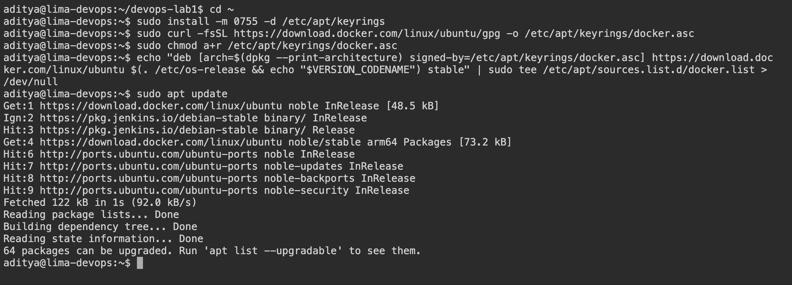

Source: [Terminal log](evidence/logs/01-docker-apt-repository.txt)

### E02 - Docker Engine installation

`sudo apt install docker-ce docker-ce-cli containerd.io docker-buildx-plugin docker-compose-plugin -y` installs Docker Engine and the Compose plugin. The user is added to the `docker` group and `systemctl is-active docker` returns `active`. Only the end of the long apt output is visible; the text log has all of it.

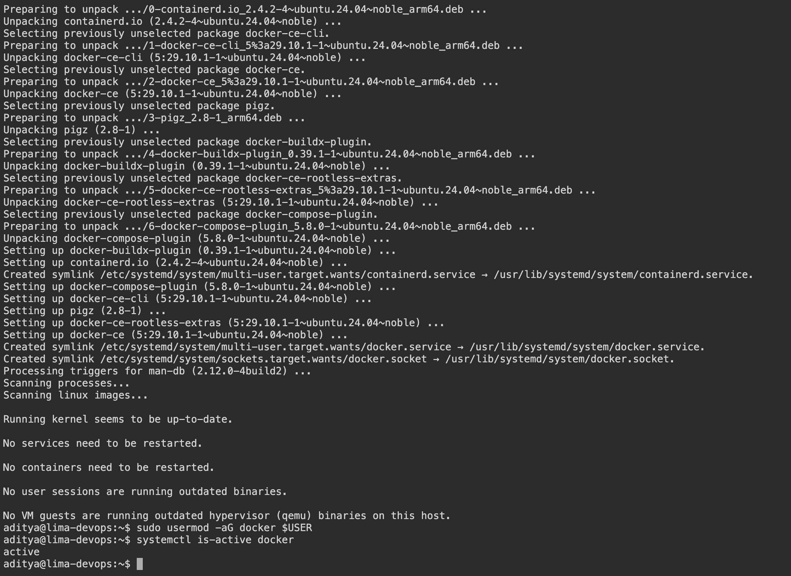

Source: [Terminal log](evidence/logs/02-docker-engine-install.txt)

### E03 - Docker versions and hello-world

After logging in again, `id -nG` lists the `docker` group. Docker 29.10.1 and Docker Compose v5.8.0 are installed and `docker run hello-world` prints *Hello from Docker!*.

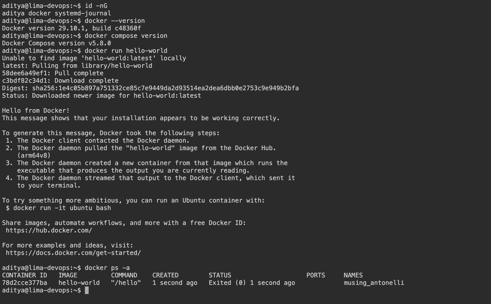

Source: [Terminal log](evidence/logs/03-docker-versions-hello-world.txt)

### E04 - Clone the repository and remove outdated evidence

The GitHub repository is cloned into `~/devops-lab2` (existing commit `b1226b6`). The earlier evidence, documents and bind-mount files are removed with `git rm` and committed as `4023945` (45 files), so that only evidence from this run remains.

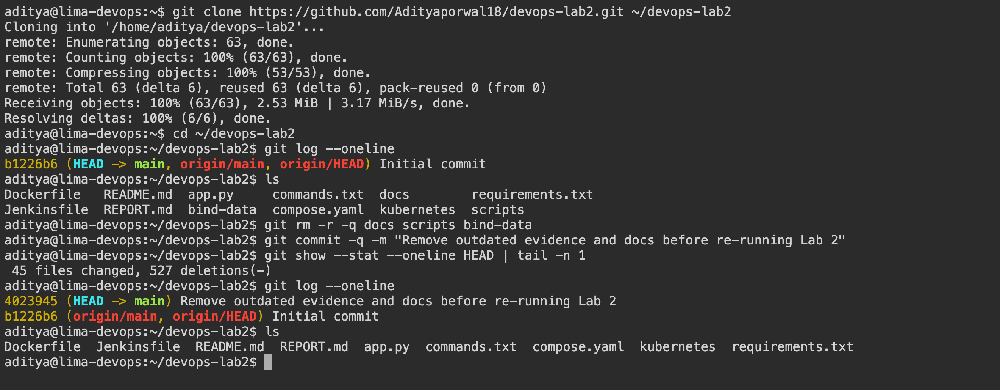

Source: [Terminal log](evidence/logs/04-clone-repo-remove-outdated-evidence.txt)

### E05 - Build image v1

The application is set to Version 1 (commit `6c69ae6`), the Dockerfile is shown and `docker build -t devops-lab2:v1 .` builds the image from `python:3.12-slim`. `docker images` lists `devops-lab2:v1` (223 MB on disk).

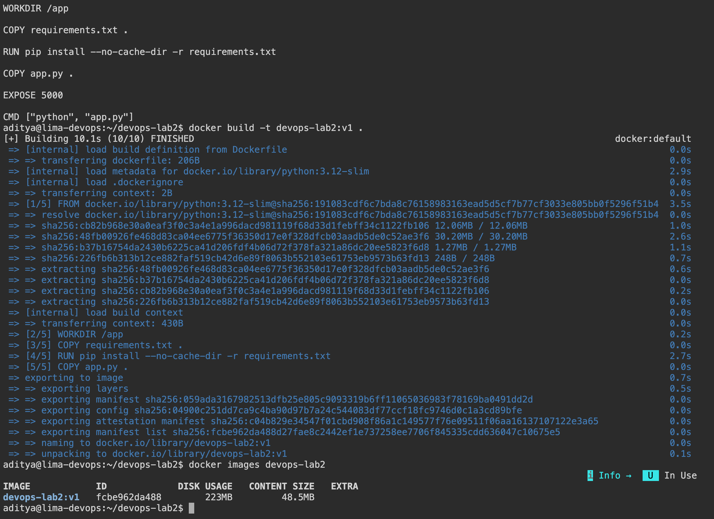

Source: [Terminal log](evidence/logs/05-docker-build-v1.txt)

### E06 - Image layers

`docker history devops-lab2:v1` lists the layers: the Dockerfile steps (WORKDIR, COPY requirements.txt, pip install - 15.5 MB, COPY app.py, EXPOSE, CMD) on top of the Python base image layers.

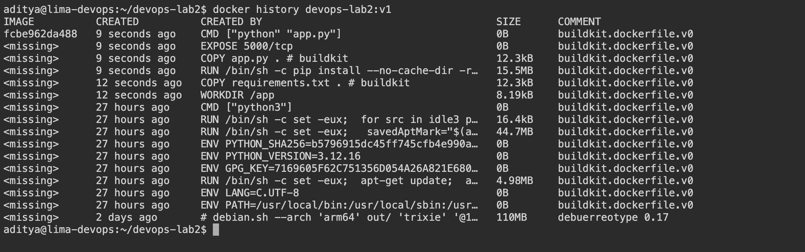

Source: [Terminal log](evidence/logs/06-docker-history-v1.txt)

### E07 - Run the container and test it

The container `lab2-app` is started with port 5000 published. `docker ps` shows it running, `curl http://localhost:5000` returns the Version 1 page and `/health` returns `{"status":"healthy"}`.

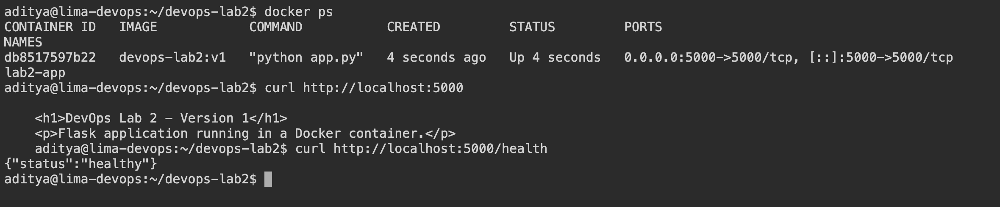

Source: [Terminal log](evidence/logs/07-run-container-and-curl.txt)

### E08 - Application in the browser (v1)

The page served by the `lab2-app` container on port 5000, opened in a browser: *DevOps Lab 2 - Version 1*.

## Q2 - Manage Docker containers and images

### E09 - List, stop and start containers

`docker ps -a` lists the containers. `lab2-app` is stopped (status *Exited*) and started again (status *Up*).

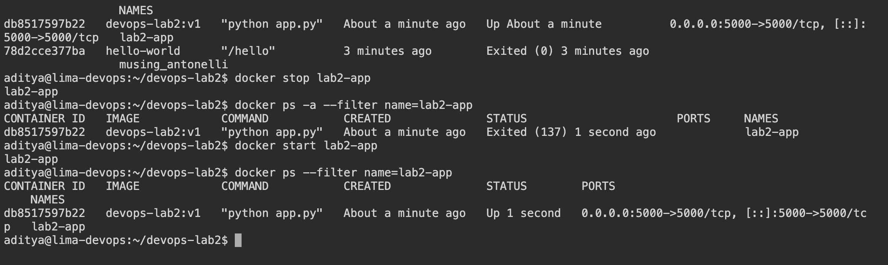

Source: [Terminal log](evidence/logs/09-container-lifecycle.txt)

### E10 - Tag an image, remove a container

The image is additionally tagged `devops-lab2:latest`; both tags point to the same image ID. A temporary container `lab2-temp` is started, stopped and removed with `docker rm`.

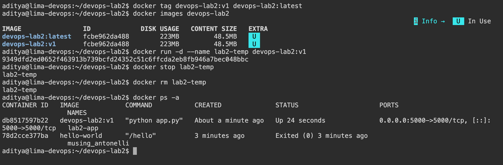

Source: [Terminal log](evidence/logs/10-image-tags-and-container-removal.txt)

### E11 - Docker Compose

`compose.yaml` defines the web service (published on port 5001) and Redis. `docker compose up -d` starts both, `docker compose ps` lists them, the page is served on port 5001, and `docker compose down` removes them.

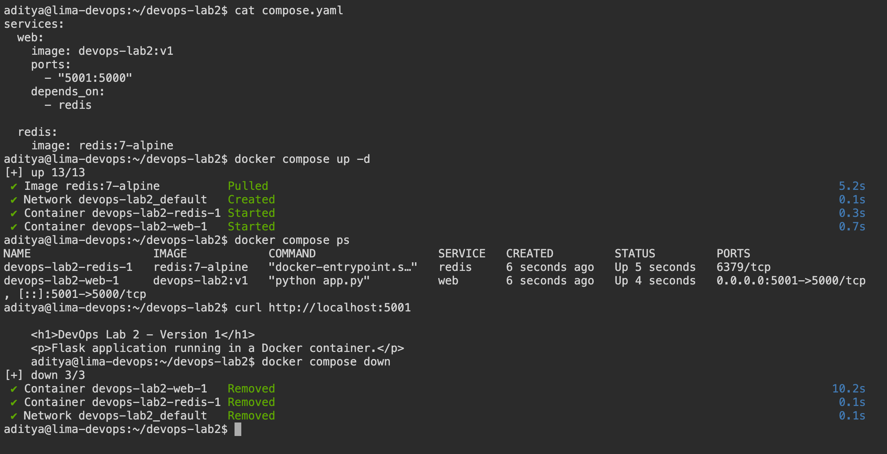

Source: [Terminal log](evidence/logs/11-docker-compose.txt)

### E12 - Docker Hub login

`docker login` uses the web-based device flow (the one-time code shown is single-use and has expired) and ends with **Login Succeeded**.

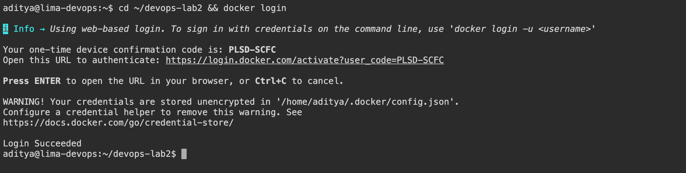

Source: [Terminal log](evidence/logs/22-docker-hub-login.txt)

### E13 - Push v1 to Docker Hub

The image is tagged `adityaporwal18/devops-lab2:v1` and pushed to Docker Hub. `docker images` lists the local images.

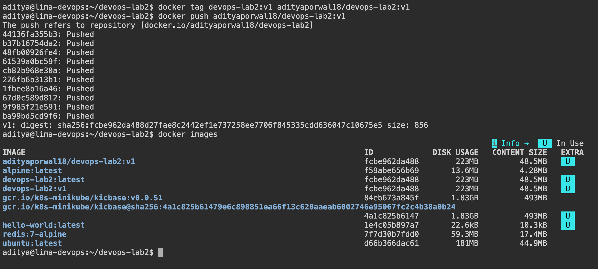

Source: [Terminal log](evidence/logs/23-docker-hub-push-v1.txt)

### E14 - Repository on Docker Hub

The public Docker Hub page of `adityaporwal18/devops-lab2` shows the tag `v1` (linux/arm64), pushed by `adityaporwal18`.

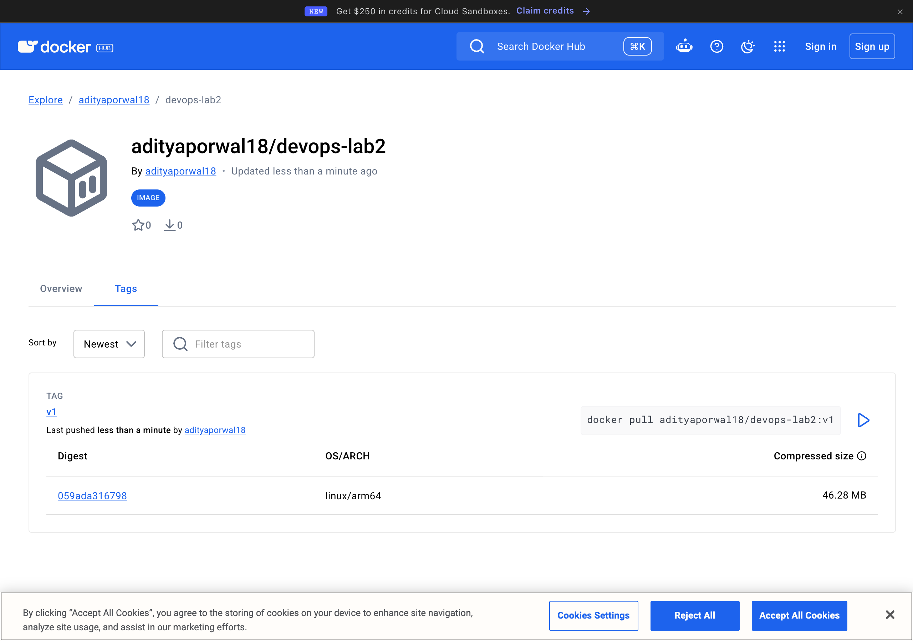

## Q3 - Docker storage

### E15 - Container-local data is lost

A file is written to `/tmp/data.txt` inside the container `storage-test`. After the container is removed, a new container cannot find the file: `No such file or directory`.

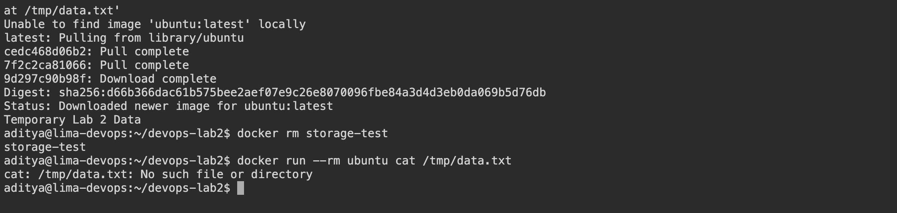

Source: [Terminal log](evidence/logs/12-storage-ephemeral-data-loss.txt)

### E16 - Named volume keeps data

Data is written to the named volume `lab2-data` by one container. That container is removed, and a new container mounting the same volume still reads *Persistent Lab 2 Data*.

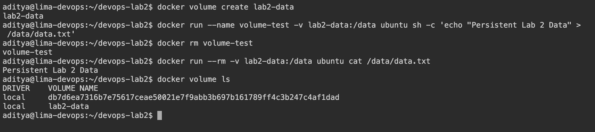

Source: [Terminal log](evidence/logs/13-storage-named-volume.txt)

### E17 - Bind mount shares files both ways

A host directory is mounted into containers. A file created on the host is read inside a container, and a file created by a container appears on the host.

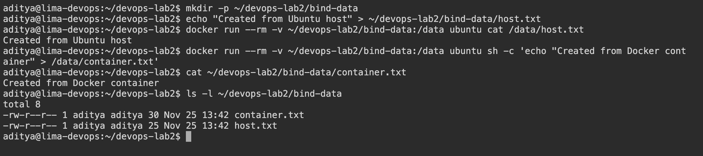

Source: [Terminal log](evidence/logs/14-storage-bind-mount.txt)

## Q4 - Docker network

### E18 - Ping by container name

Two Alpine containers are attached to the user-defined network `lab2-network`. `network-a` pings `network-b` by name: 4 packets sent, 4 received.

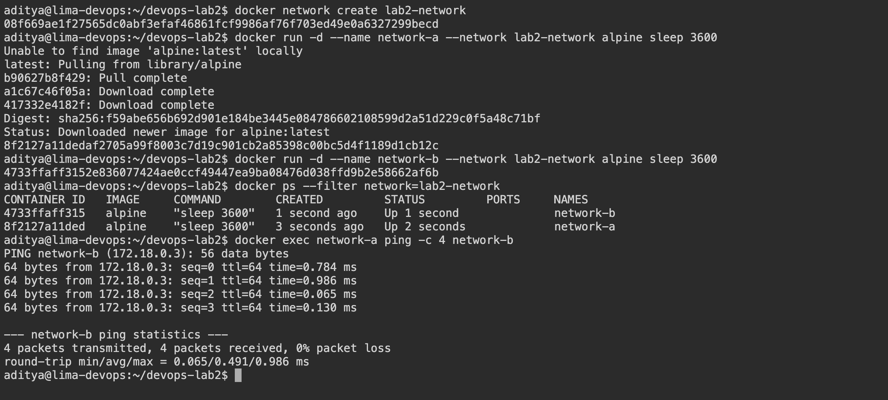

Source: [Terminal log](evidence/logs/15-network-ping-by-container-name.txt)

### E19 - Ping by IP address

`docker inspect` returns the address of `network-b` (172.18.0.3) and `network-a` pings that address: 0% packet loss.

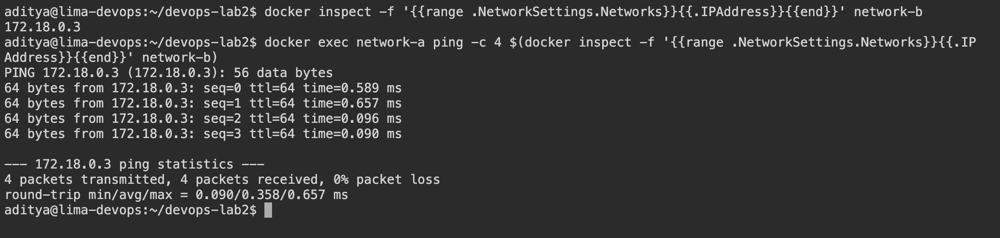

Source: [Terminal log](evidence/logs/16-network-ping-by-ip-address.txt)

### E20 - Inspect the network

`docker network inspect lab2-network` shows a bridge network with subnet 172.18.0.0/16 and both containers attached (`network-a` 172.18.0.2, `network-b` 172.18.0.3).

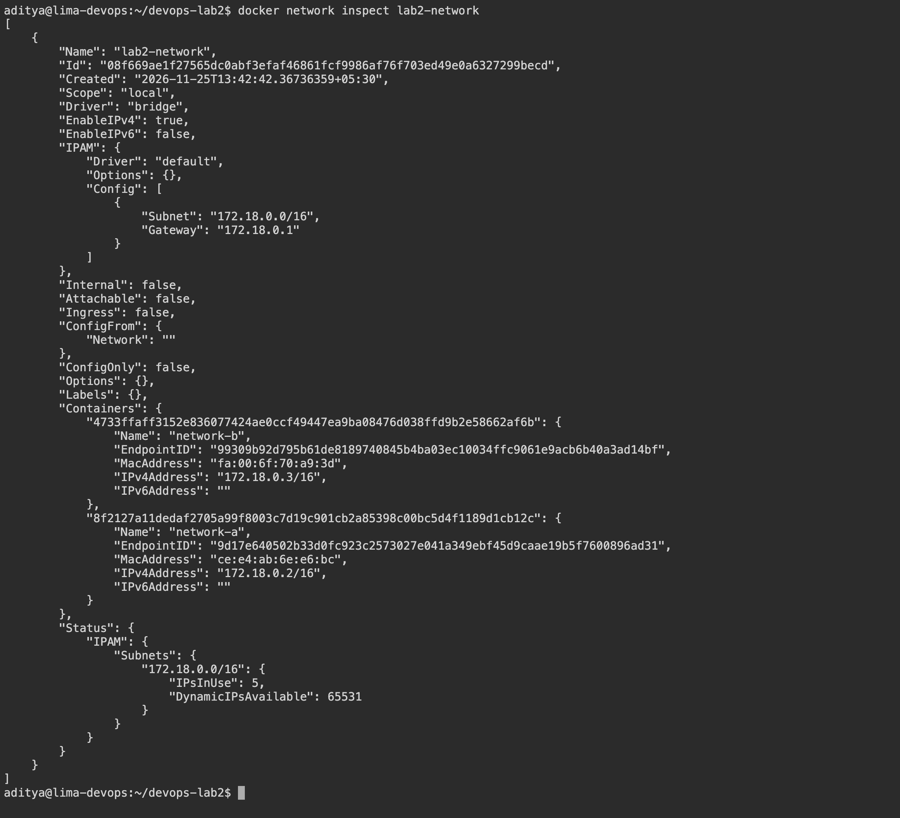

Source: [Terminal log](evidence/logs/17-network-inspect.txt)

### E21 - Remove the test containers and network

The two test containers and the network are removed; `docker network ls` no longer lists `lab2-network`.

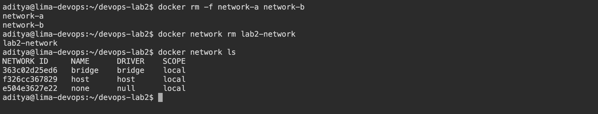

Source: [Terminal log](evidence/logs/18-network-cleanup.txt)

## Q5 - Deploy an application to Kubernetes

### E22 - Install kubectl and Minikube

The kubectl and Minikube binaries for linux/arm64 are downloaded and installed to `/usr/local/bin`: kubectl v1.37.2, Minikube v1.39.0.

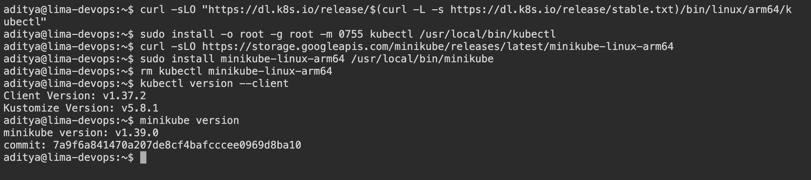

Source: [Terminal log](evidence/logs/19-install-kubectl-and-minikube.txt)

### E23 - Start Minikube

`minikube start --driver=docker` creates a single-node cluster (Kubernetes v1.37.0, containerd, 2 CPUs, 3072 MB) and warns that this memory allocation is high for a 3.9 GB VM. Six seconds after start the node is still `NotReady`; `minikube status` shows host, kubelet and apiserver running.

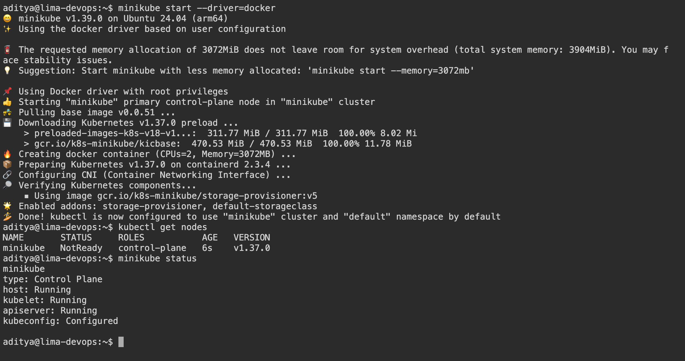

Source: [Terminal log](evidence/logs/20-minikube-start-node-ready.txt)

### E24 - Node Ready

A moment later the node `minikube` is **Ready** and all `kube-system` pods are Running.

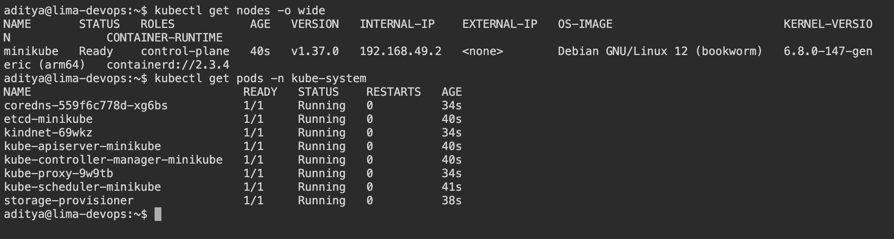

Source: [Terminal log](evidence/logs/21-kubernetes-node-ready.txt)

### E25 - Apply the Deployment and Service

The Deployment manifest is changed to the Docker Hub image `adityaporwal18/devops-lab2:v1` (commit `db120df`). Both manifests are applied, the rollout completes, and the Deployment shows 2/2 replicas with two Running pods and a NodePort Service on 30080.

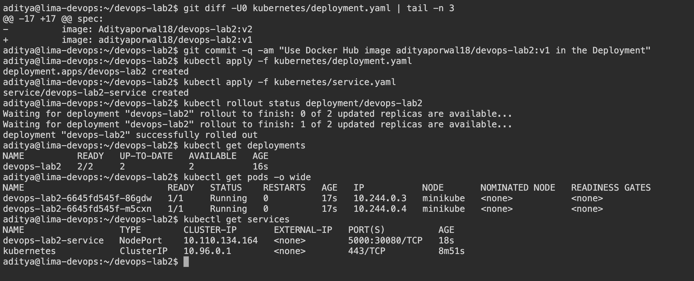

Source: [Terminal log](evidence/logs/25-kubernetes-deploy-v1.txt)

### E26 - Access the Service with port-forward

`kubectl port-forward` exposes the Service on local port 8081. `curl` returns the Version 1 page and the health response, and the Deployment's image is `adityaporwal18/devops-lab2:v1`.

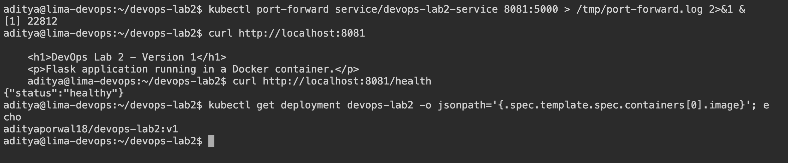

Source: [Terminal log](evidence/logs/26-kubernetes-port-forward-v1.txt)

### E27 - Kubernetes application in the browser (v1)

The application served through the Kubernetes Service (port-forward on 8081), opened in a browser: Version 1.

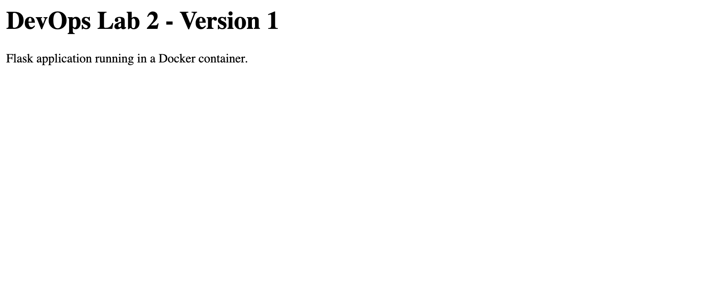

## Q6 - Kubernetes deployment strategies

### E28 - Scale to four replicas

`kubectl scale deployment devops-lab2 --replicas=4`: the Deployment reports 4/4 and four pods are Running.

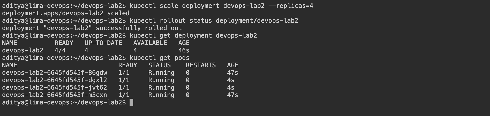

Source: [Terminal log](evidence/logs/28-kubernetes-scale-to-four-replicas.txt)

### E29 - Build and push v2

The page text is changed to Version 2 (commit `af59436`), the image `adityaporwal18/devops-lab2:v2` is built and pushed to Docker Hub. Both tags are listed locally.

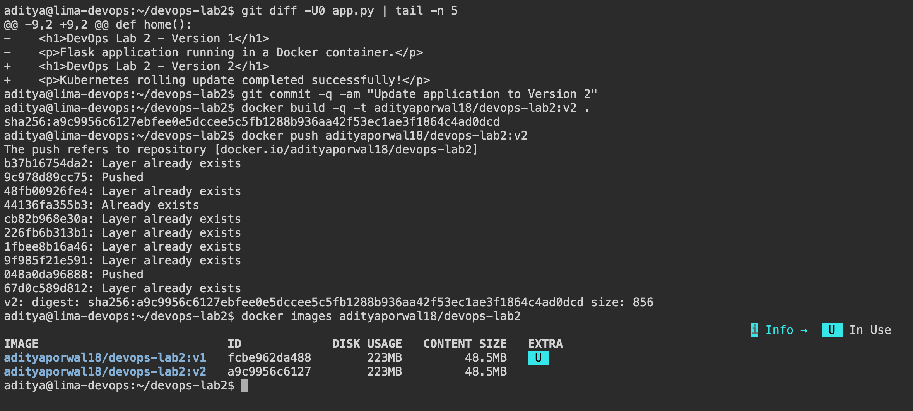

Source: [Terminal log](evidence/logs/29-build-and-push-v2.txt)

### E30 - Rolling update to v2

`kubectl set image` changes the Deployment to v2 and the rollout completes. `kubectl get pods` shows the four old pods Terminating and four new pods Running; the Deployment's image is now `adityaporwal18/devops-lab2:v2`.

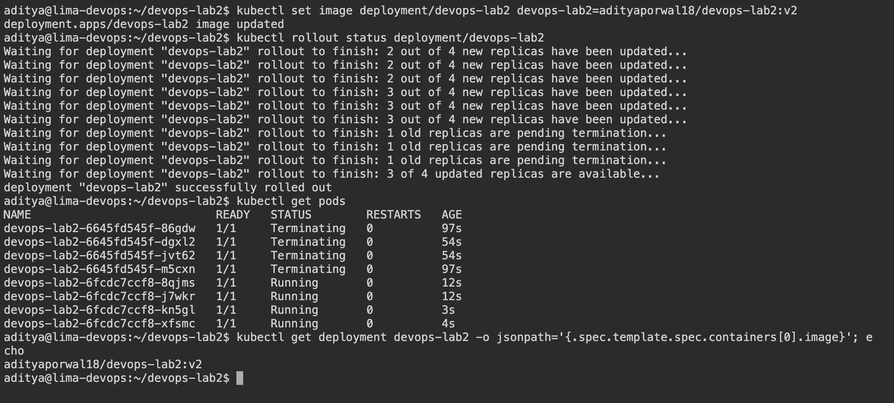

Source: [Terminal log](evidence/logs/30-kubernetes-rolling-update-v2.txt)

### E31 - Version 2 response

After restarting the port-forward, `curl http://localhost:8081` returns the Version 2 page.

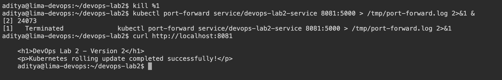

Source: [Terminal log](evidence/logs/31-kubernetes-v2-response.txt)

### E32 - Kubernetes application in the browser (v2)

The updated application through the Kubernetes Service, opened in a browser: Version 2.

### E33 - Rollback

`kubectl rollout history` shows revisions 1 and 2. `kubectl rollout undo` rolls back; the image is `adityaporwal18/devops-lab2:v1` again, new v1 pods are Running while the v2 pods terminate, and the history now shows revisions 2 and 3.

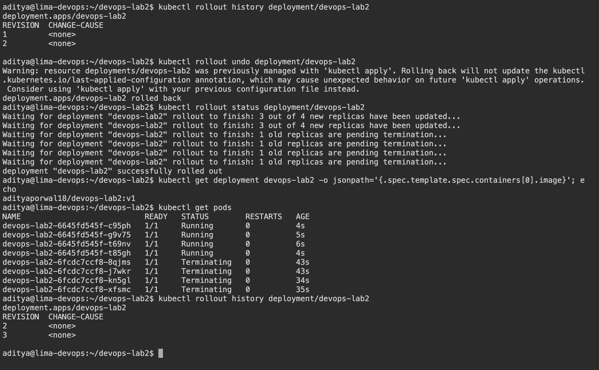

Source: [Terminal log](evidence/logs/33-kubernetes-rollback-to-v1.txt)

## Q7 - Configure continuous deployment

### E34 - Give Jenkins access to kubectl

A sudoers rule lets the `jenkins` user run `/usr/local/bin/kubectl` as `aditya` (the user that owns the Minikube configuration). The rule passes `visudo -c`, and the test command lists the Ready node.

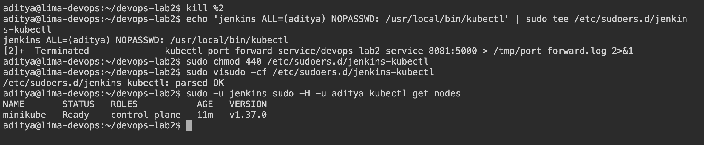

Source: [Terminal log](evidence/logs/34-jenkins-kubectl-access.txt)

### E35 - Commit and push the pipeline files

The updated Jenkinsfile, the Jenkins job configuration and the bind-mount files are committed (`e036689`) and all commits of this run are pushed to GitHub (`b1226b6..e036689`).

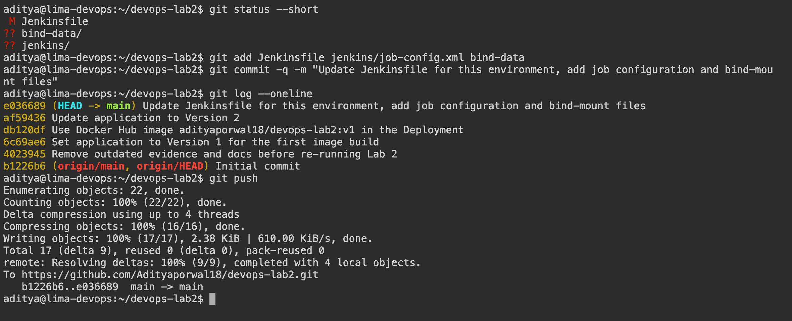

Source: [Terminal log](evidence/logs/35-git-push-lab2.txt)

### E36 - Pipeline job configuration

Configuration page of the job `devops-lab2` (full page): Pipeline script from SCM, Git, repository `https://github.com/Adityaporwal18/devops-lab2.git`, branch `*/main`, script path `Jenkinsfile`, and the Poll SCM trigger registered from the Jenkinsfile. The Save/Apply bar appears in the middle because it is a floating element of the page.

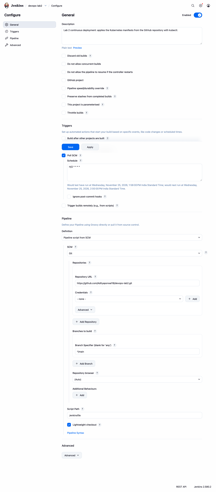

### E37 - Build #1 console - start

Build #1 is **Started by user Aditya Porwal** and checks out revision `e036689` from the GitHub repository.

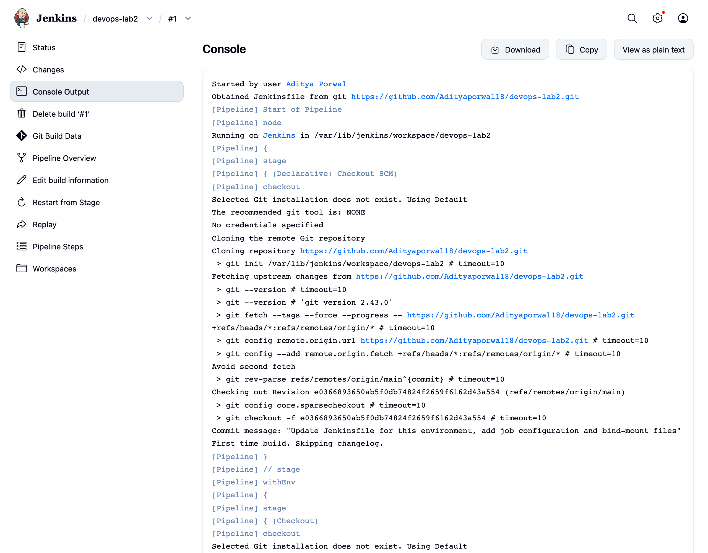

Source: [Full console log](evidence/logs/jenkins-build-1-console.txt)

### E38 - Build #1 console - result

End of build #1: the Verify stage lists the Deployment, pods and Services, the post action prints `Continuous deployment completed successfully!` and the build ends with **Finished: SUCCESS**. This build applied the manifest from Git, which returned the Deployment to 2 replicas.

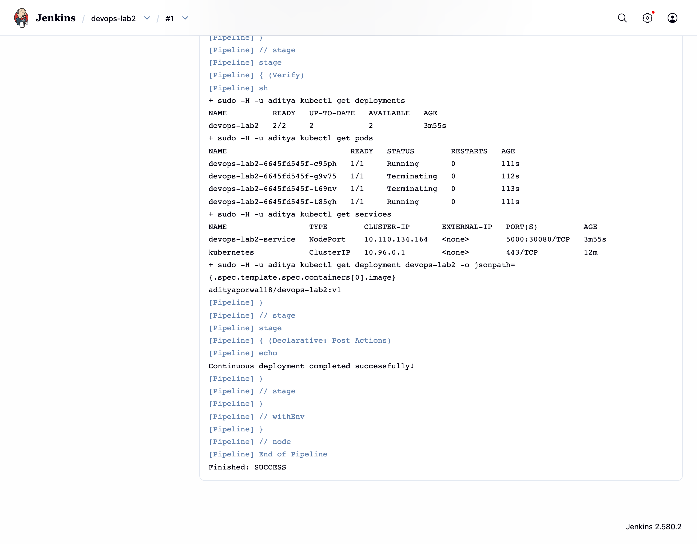

Source: [Full console log](evidence/logs/jenkins-build-1-console.txt)

### E39 - Push a manifest change (v2)

The image in `kubernetes/deployment.yaml` is changed from v1 to v2, committed (`91e8441`) and pushed at 13:59:37 IST. No build was started manually after this push.

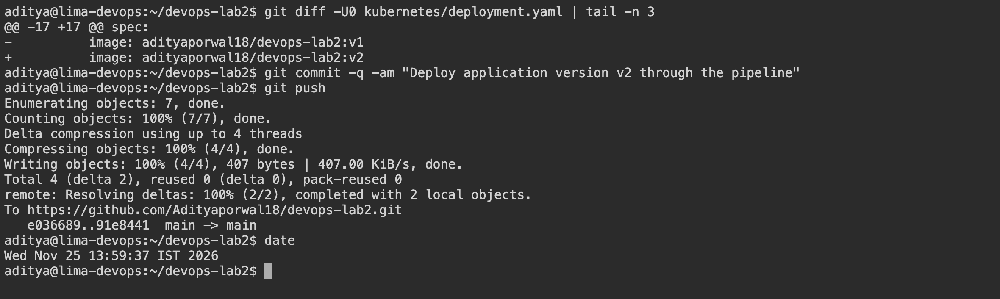

Source: [Terminal log](evidence/logs/39-push-v2-manifest-for-continuous-deployment.txt)

### E40 - Build #2 started by an SCM change

Build #2 begins with **Started by an SCM change**: polling detected the new commit and Jenkins started the deployment automatically.

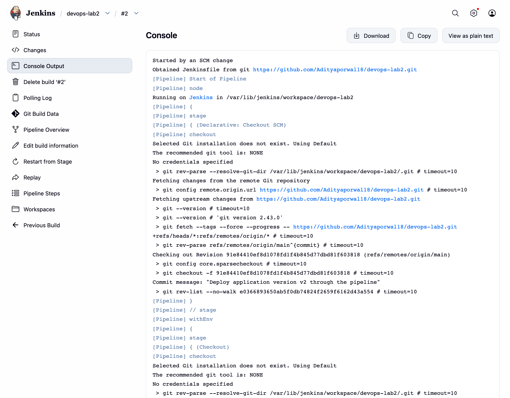

Source: [Full console log](evidence/logs/jenkins-build-2-console.txt) | [Polling log with "Changes found" (2:00 PM)](evidence/logs/jenkins-scm-polling-log.txt)

### E41 - Build #2 console - result

Build #2 applies the changed manifest, waits for the rollout, verifies that the image is `adityaporwal18/devops-lab2:v2` and ends with **Finished: SUCCESS**.

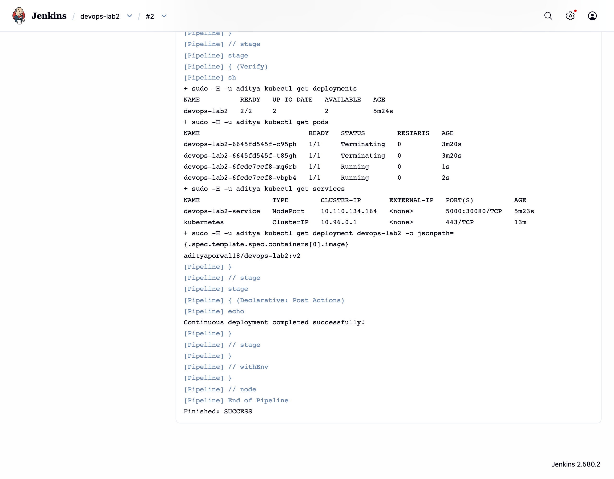

Source: [Full console log](evidence/logs/jenkins-build-2-console.txt)

### E42 - Build #2 pipeline stages

Stage view of build #2: Checkout, Deploy to Kubernetes, Verify and Post Actions all succeeded.

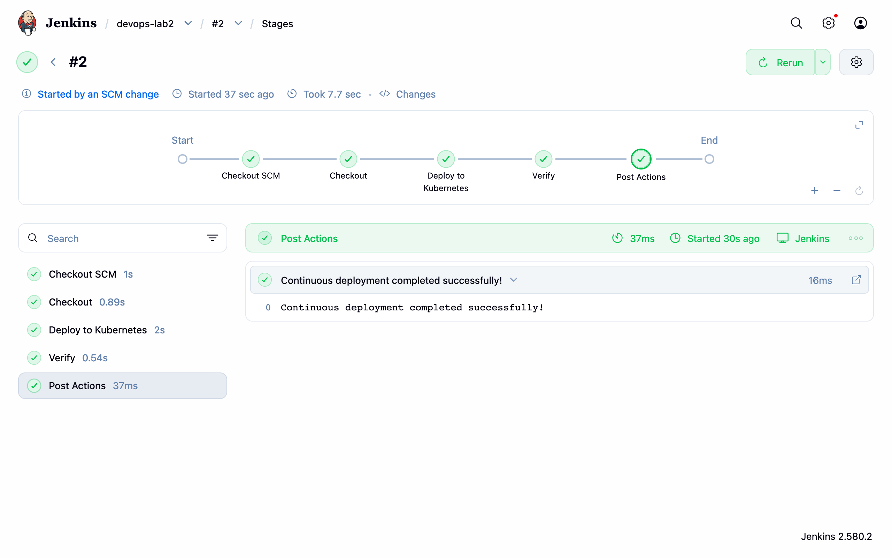

### E43 - Git polling log

The Git polling log as shown after build #2 (poll of 2:02 PM): the remote head `91e8441` is reported as *already built by 2*, so there are **No changes**. Jenkins overwrites this page at every poll; the earlier poll of 2:00 PM, which reported *Changes found* and started build #2, is kept as a text log.

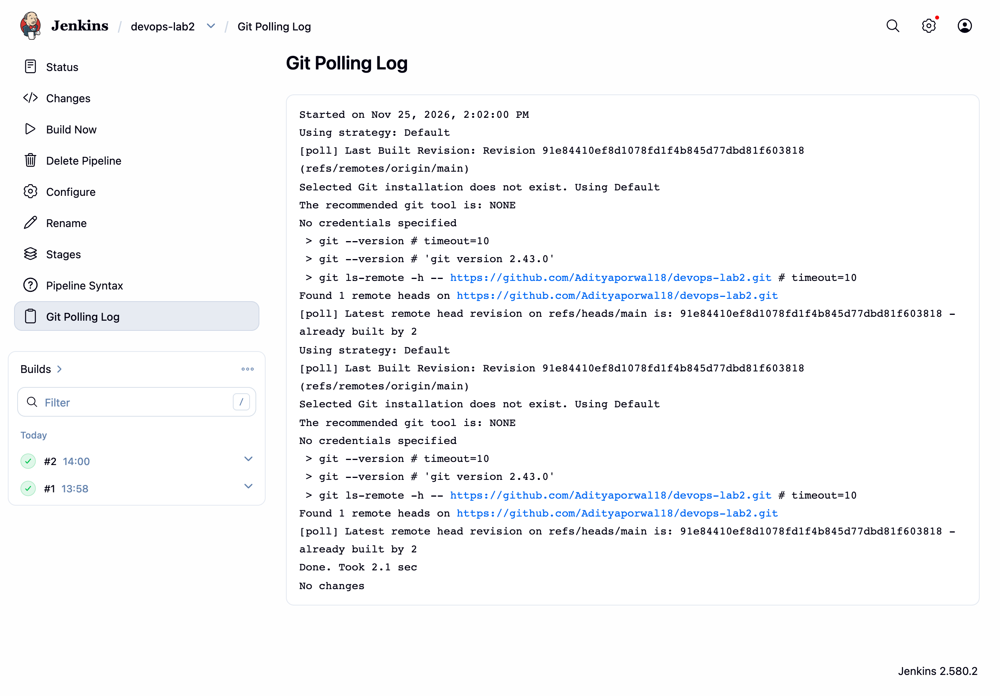

Source: [Polling log of 2:00 PM (Changes found)](evidence/logs/jenkins-scm-polling-log.txt)

### E44 - Build history

Job page of `devops-lab2`: builds #1 (13:58) and #2 (14:00) are both successful.

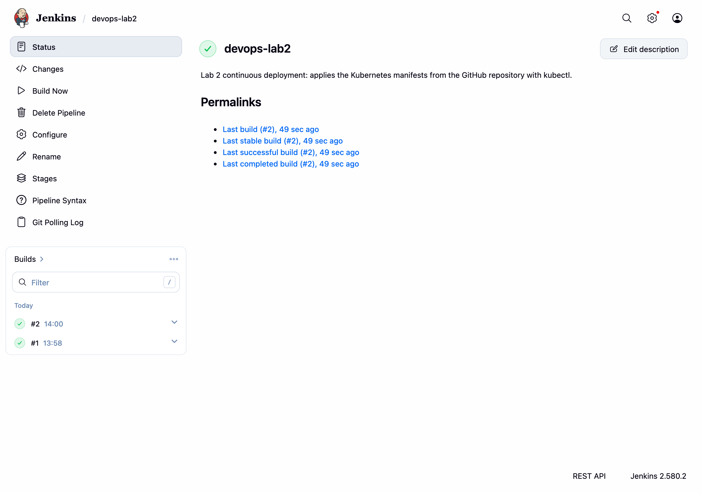

### E45 - Cluster state after continuous deployment

After build #2 the Deployment has 2/2 replicas, two Running pods and the image `adityaporwal18/devops-lab2:v2`. Through port-forward the Service returns the Version 2 page.

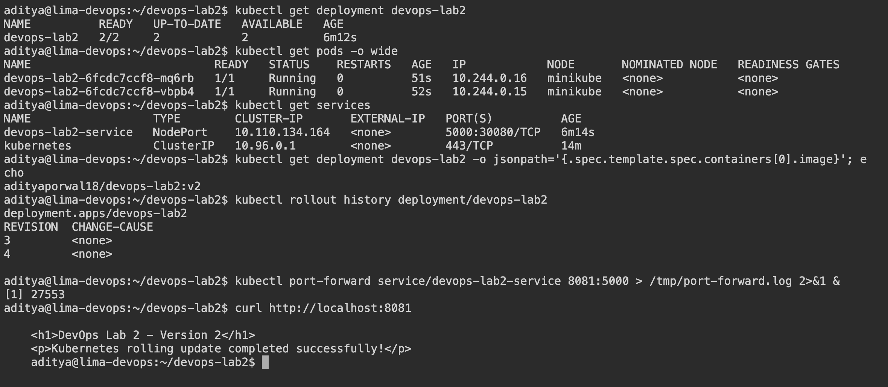

Source: [Terminal log](evidence/logs/45-final-kubernetes-state-v2.txt)

### E46 - Deployed application in the browser (v2)

The application deployed by Jenkins, opened in a browser through the Kubernetes Service: Version 2.

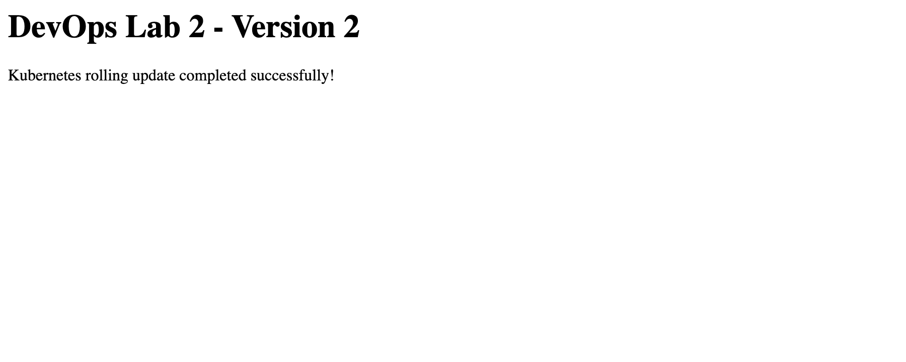

## Q8-Q9 - Tools, documents and report

### E47 - Tool versions

Versions of the tools used: Docker 29.10.1, Docker Compose v5.8.0, kubectl v1.37.2, Minikube v1.39.0, Jenkins 2.580.2, Python 3.12.3 and Git 2.43.0.

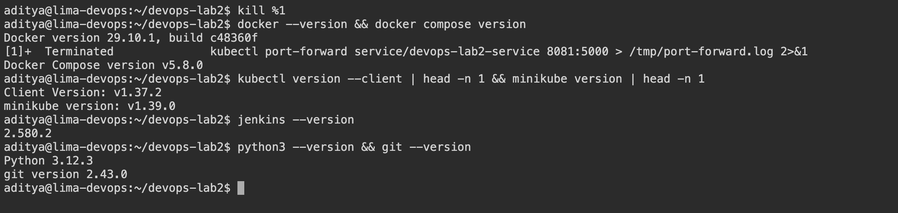

Source: [Terminal log](evidence/logs/47-tool-versions.txt)

### E48 - Commit and push the documentation

The evidence gallery, command record, report and screenshots are committed and pushed to GitHub.

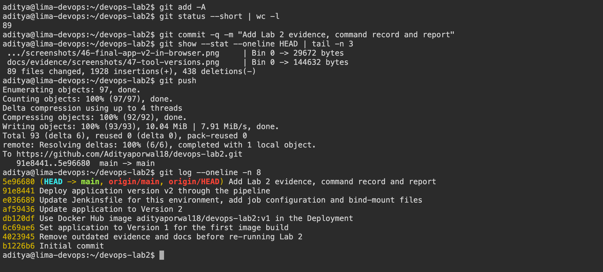

Source: [Terminal log](evidence/logs/48-commit-and-push-documentation.txt)

### E49 - Build history after the documentation push

The documentation push was also picked up by SCM polling: build #3 started automatically, re-applied the unchanged manifests and succeeded.

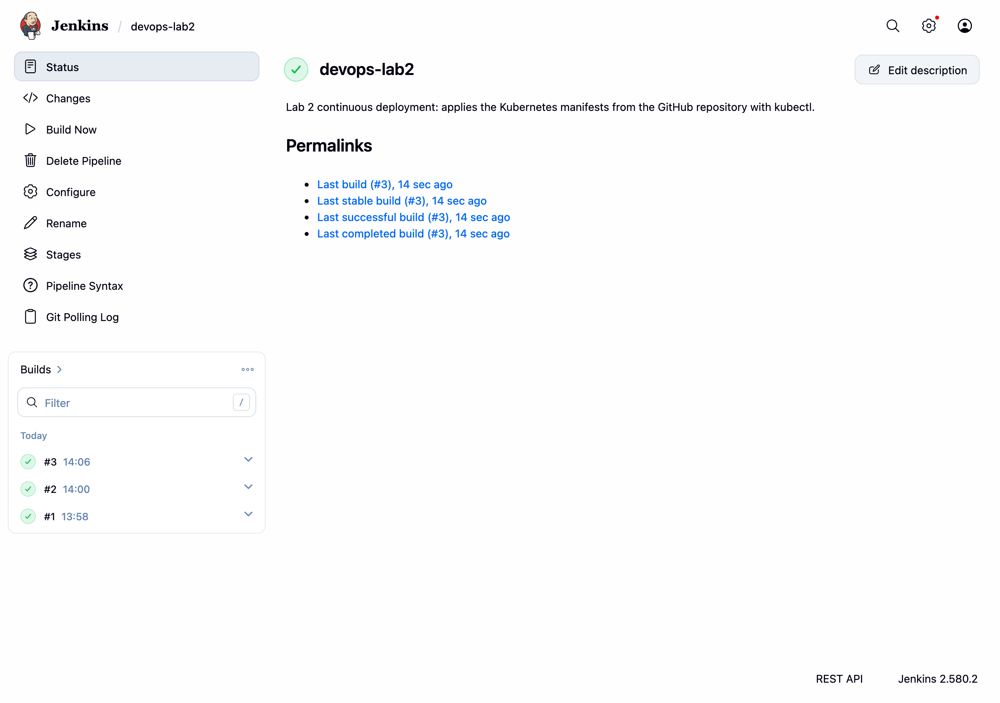

### E50 - Final repository on GitHub

The repository on GitHub with the Dockerfile, Compose file, Kubernetes manifests, Jenkinsfile, report, command record and the `docs` folder.

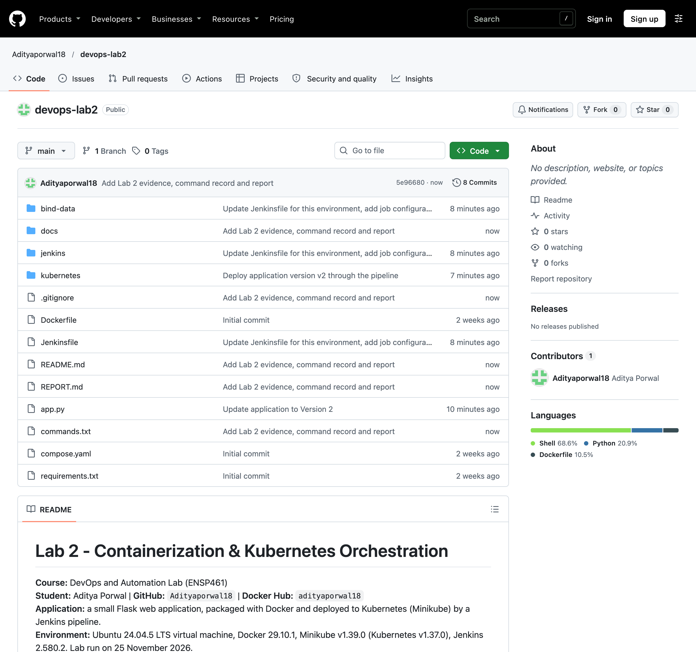
